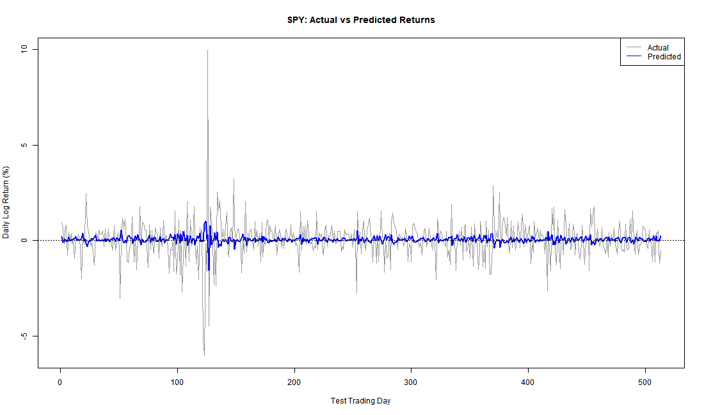

# Quantitative Research in R

## Project Overview
This project explores statistical models used to analyze financial market data.

## Research Objective
Investigate whether historical stock returns can help predict future returns.

## Tools
- R programming
- Regression analysis
- Statistical modeling
- Historical stock market data

## Research Methodology

- Downloaded historical SPY market data using R and quantmod.
- Calculated daily logarithmic returns.
- Used linear regression to investigate whether yesterday's return predicts today's return.
- Trained the model on the earliest 70% of observations.
- Evaluated predictions on the remaining 30%.

## Research Results

- Regression coefficient: -0.16058
- Training p-value: 2.33e-08
- Training R-squared: 0.02578
- Out-of-sample model RMSE: 1.0248 percentage points
- Baseline RMSE: 1.0268 percentage points
- Out-of-sample R-squared: 0.00383

## Conclusion

The regression identified a statistically significant negative relationship in the training sample. However, the improvement in out-of-sample prediction accuracy was very small. These results do not establish a profitable trading strategy.

## Visualization

